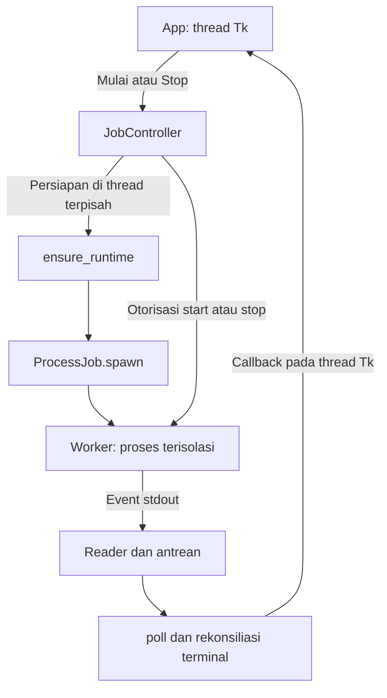

# Peta kode dan alur fungsi

[Kembali ke dokumentasi](README.md) · [Kontrak arsitektur](arsitektur.md) · [Pengembangan dan tes](pengembangan.md)

Gunakan panduan ini untuk menemukan tempat perubahan dan mengikuti alur sebuah
pekerjaan. Nama di bawah adalah simbol yang bisa dicari langsung dengan `rg`;
fungsi berawalan `_` merupakan detail internal, bukan API baru untuk pemanggil luar.
Aturan identitas, akses, status, dan publikasi tetap dimiliki [arsitektur](arsitektur.md).

## 1. Mulai dari pintu masuk yang benar

| Jalur | Fungsi pertama yang dibaca | Tugasnya dan batasnya |
| --- | --- | --- |
| CLI | [`coretax.main`, `_main`, `parser`](../coretax.py) | Memilih pengambilan baru, `--resume`, atau `--from-json`. Jalur offline membaca capture yang ada lalu memanggil `save_output` tanpa membuat browser. |
| Jendela desktop | [`spt_gui.main`, `_run_gui`](../spt_gui.py), [`App.start`](../spt_desktop/app.py) | Membuka GUI tipis dan meneruskan pilihan pengguna ke controller. Membuka jendela saja tidak menyiapkan runtime worker atau mulai mengambil SPT. |
| Pengendali pekerjaan | [`JobController._start_worker`](../spt_desktop/controller.py) | Menyiapkan runtime di thread terpisah, membuat worker milik aplikasi, dan mengirim otorisasi `start` atau `stop`. |
| Worker desktop | [`worker.main`, `_authorized`, `run_job`](../spt_desktop/worker.py) | Menunggu otorisasi parent, lalu mengerjakan login, inventaris, pilihan pengguna, detail, ekspor, dan publikasi. |

**Default berbeda menurut pintu masuk.** [`app.DEFAULTS` dan `load_preferences`](../spt_desktop/app.py)
memakai `json-first` untuk pengaturan desktop baru dan mempertahankan pilihan DOM
yang sudah tersimpan. [`coretax.parser`](../coretax.py), [`JobController.start`](../spt_desktop/controller.py),
dan [`worker.run_job`](../spt_desktop/worker.py) tetap memakai `dom` bila pemanggil
tidak memberikan mode. GUI meneruskan preferensinya secara eksplisit. Jangan
menyimpulkan perilaku pengguna hanya dari default satu fungsi.

### Batas GUI dan worker



Diagram menunjukkan kepemilikan proses dan event. Payload pilihan SPT/penggantian
hasil memakai berkas privat di folder job melalui [`interaction.Requests`](../spt_desktop/interaction.py);
stdout/stdin membawa sinyal dengan identitas job/request. Worker tidak mengubah
widget Tk dan GUI tidak mengimpor Playwright/openpyxl.

## 2. Ikuti satu pekerjaan ekspor

1. **Siapkan sesi dan scope.** CLI memakai [`authenticate`](../coretax.py);
   desktop memakai [`authenticate_owned`](../spt_desktop/auth.py).
   [`validate_scope`](../coretax_exporter.py) memeriksa NPWP/tahun tanpa memperbaiki
   identitas yang salah. Kesiapan login ditentukan kontrol pencarian yang terlihat.
2. **Bangun inventaris.** [`collect_inventory` dan `ListObserver`](../coretax_browser.py)
   menghubungkan baris UI dengan respons, scope, dan posisi halaman. Filter tahun
   didukung oleh [`plan_year_filters`](../coretax_inventory.py). Desktop kemudian
   memanggil [`select_records`](../spt_desktop/interaction.py) untuk membentuk subset
   dari ID yang dipilih; subset harus membuktikan kelengkapan detailnya kembali.
3. **Ambil detail.** [`collect_details`](../coretax_browser.py) mencoba checkpoint
   yang cocok melalui `read_detail_checkpoint`, atau membuka `View` lewat
   `open_return_readonly`. DOM memakai `capture_detail`; mode JSON-hybrid memakai
   `_hybrid_detail`, observer, adapter, dan projection yang sesuai jenis pajak.
   Identitas/otorisasi yang salah menghentikan jalur tersebut; fallback DOM
   menangani format, cakupan, atau capture native yang belum memenuhi syarat.
4. **Tulis dan baca ulang hasil privat.** [`save_output`](../coretax.py) menjalankan
   [`export_split_workbooks`](../coretax_exporter.py), memverifikasi set melalui
   `verify_outputs`, menulis `run.json`, lalu mempublikasikan set dari staging.
   [`pdf_custody`](../coretax_pdf.py) memegang stream PDF terverifikasi selama proses.
5. **Publikasikan hasil desktop dan selesaikan job.** Worker memanggil
   [`existing_outputs` dan `publish_workbooks`](../spt_desktop/output.py), meminta
   persetujuan jika file SPT/PDF terpilih akan diganti, lalu mengirim event terminal.
   [`JobController._finish`](../spt_desktop/controller.py) menyelaraskan event,
   exit code, Stop, selesainya reader, dan lokasi hasil sebelum GUI menyatakan selesai.

Pada CLI, folder dari `--output` adalah tujuan hasilnya. Pada desktop, tahap 4
berada dalam folder job privat dan tahap 5 menyalin hasil terverifikasi ke Downloads
yang ditentukan Windows. `save_output` dan `publish_workbooks` menjaga dua batas
publikasi berbeda; keduanya perlu dibaca saat memperbaiki masalah penggantian file.

## 3. Pilih fungsi dan tes sesuai perubahan

Tautan tes berikut adalah titik mulai untuk membaca kontrak yang sudah ada,
bukan daftar lengkap tes yang boleh dijalankan. Suite Windows dan agregasi
inventory CI tetap menentukan cakupan penuh.

### Capture, sumber data, dan Excel/PDF

| Perubahan | Fungsi/modul yang dibaca | Tes awal yang relevan |
| --- | --- | --- |
| Filter masa/tahun dan duplikasi inventaris | [`plan_year_filters`, `prove_period_equivalence`](../coretax_inventory.py); [`deduplicate_inventory`](../coretax_exporter.py) | [Filter tahun](../tests/test_inventory_year_filter.py), [konflik metadata](../tests/test_period_metadata_conflict.py) |
| Navigasi View, halaman berikutnya, dan pemulihan detail | [`collect_inventory`, `open_return_readonly`, `collect_details`, `read_detail_checkpoint`](../coretax_browser.py) | [Binding daftar](../tests/test_inventory_list_binding.py), [pemulihan](../tests/test_capture_recovery.py), [scope resume](../tests/test_resume_capture_scope.py) |
| Kelayakan JSON-hybrid dan fallback | [`_hybrid_detail`](../coretax_browser.py), [`DetailJsonCapture`](../coretax_json_capture.py), [`adapt_corporate_detail`](../coretax_json.py), [`adapt_masa_detail`](../coretax_masa_json.py) | [Penolakan hybrid](../tests/test_json_hybrid_rejections.py), [identitas request](../tests/test_json_hybrid_request_identity.py), [dispatch Masa](../tests/test_masa_json_dispatch_safety.py) |
| Nama workbook, form, nilai literal, dan proof | [`workbook_groups`, `record_forms`, `workbook_proof`, `read_workbook_proof`, `validate_export_run`](../coretax_exporter.py) | [Workbook per model](../tests/test_model_workbooks.py), [keselamatan ekspor](../tests/test_export_safety.py), [nama sheet](../tests/test_simple_sheet_names.py) |
| Tata letak dan angka template | `render_template_form` pada [Badan](../coretax_badan_template.py), [PPh21](../coretax_pph21.py), dan [Masa](../coretax_masa_templates.py); helper [sel template](../coretax_template_cells.py) | [Layout Badan](../tests/test_corporate_template_layout.py), [PPh21 numerik](../tests/test_pph21_numeric.py), [PPN numerik](../tests/test_ppn_numeric_layout.py), [tarif Unifikasi](../tests/test_unifikasi_rate_layout.py) |
| PDF keuangan dan publikasi file | [`download_financial_attachments`](../coretax_attachments.py), [`pdf_custody`, `copy_held_pdfs`](../coretax_pdf.py), [`save_output`, `verify_outputs`](../coretax.py) | [Unduhan PDF](../tests/test_financial_attachments.py), [publikasi PDF](../tests/test_financial_publication.py), [layout PDF datar](../tests/test_financial_flat_layout.py) |

Adapter mengubah respons teramati menjadi bentuk yang bisa diverifikasi; observer
mengumpulkan bukti keterkaitan dengan UI, dan projection memetakan bukti yang layak
ke form. Modul observer/projection PPN dan Unifikasi ada pada `coretax_masa_*`;
PPh21 memakai `coretax_pph21_*`, sedangkan observasi Badan ada pada
[`coretax_corporate.py`](../coretax_corporate.py). Ketiganya tidak boleh
digabungkan menjadi tebakan alias JSON berdasarkan kemiripan nama.

### Desktop, diagnostik, dan CI

| Perubahan | Fungsi/modul yang dibaca | Tes awal yang relevan |
| --- | --- | --- |
| Dialog, pencarian, dan urutan pilihan | [`App.selection_dialog`, `App.overwrite_dialog`, `_selection_detail_key`](../spt_desktop/app.py); [state](../spt_desktop/ui_state.py), [copy](../spt_desktop/ui_copy.py), [views](../spt_desktop/ui_views.py) | [Urutan pilihan](../tests/test_desktop_selection_sorting.py), [kesiapan dialog](../tests/test_desktop_dialog_readiness.py), [state UI](../tests/test_desktop_ui_state.py) |
| Jawaban pilihan/penggantian yang terlambat | [`Requests.request`, `read_message`, `select_records`](../spt_desktop/interaction.py), [`JobController.respond`](../spt_desktop/controller.py) | [Lifecycle persetujuan](../tests/test_desktop_consent_lifecycle.py), [transport pilihan](../tests/test_desktop_selection_transport.py) |
| Stop dan proses anak | [`JobController.stop`, `poll`, `_finish`](../spt_desktop/controller.py), [`ProcessJob.spawn`](../spt_desktop/windows.py), [`worker._authorized`](../spt_desktop/worker.py) | [Lifecycle](../tests/test_desktop_lifecycle_audit.py), [Windows](../tests/test_desktop_windows.py), [orkestrasi](../tests/test_desktop_orchestration.py) |
| Runtime, paket, dan resource worker | [`ensure_runtime`, `_resources`, `WORKER_FILES`](../spt_desktop/runtime.py), [`build_desktop.py`](../build_desktop.py) | [Runtime](../tests/test_desktop_runtime.py), [build](../tests/test_desktop_build.py), [lock](../tests/test_dependency_locks.py) |
| Login unduhan dan kredensial tersimpan | [`authenticate_owned`, `try_saved_login`](../spt_desktop/auth.py), [`credentials.py`](../spt_desktop/credentials.py), [`run_job`](../spt_desktop/worker.py) | [Binding login](../tests/test_desktop_login_binding.py), [login unduhan](../tests/test_desktop_login_check.py), [redirect sintetis](../tests/test_desktop_login_redirect.py), [penolakan command lama](../tests/test_desktop_login_check_transport.py) |
| Penggantian hasil dan rollback | [`publish_workbooks`, `_replace_selected`, `_rollback`](../spt_desktop/output.py), [`DirectoryGuard`, `locked_file`](../spt_desktop/output_windows.py) | [Keselamatan overwrite](../tests/test_desktop_overwrite_safety.py), [migrasi model](../tests/test_model_workbook_migration_safety.py) |
| Log dan waktu per tahap | [`record`, `measure`, `traced`](../spt_desktop/diagnostics.py), [`SegmentStore`](../spt_desktop/diagnostic_store.py) | [Diagnostik](../tests/test_diagnostics.py), [pengukuran capture](../tests/test_benchmark_diagnostics.py) |
| Routing, shard, dan artifact | [`choose_mode`, `validate_needs`](../scripts/ci_route.py), [`shard_for`, `check_inventories`](../scripts/ci_tests.py), [`verify`](../scripts/ci_artifact.py) | [Routing](../tests/test_ci_routing.py), [sharding](../tests/test_ci_sharding.py), [artifact](../tests/test_ci_artifacts.py) |

## 4. Kenali bukti yang sedang dibaca

| Bentuk data | Pemilik utama | Arti dan batasnya |
| --- | --- | --- |
| `run`: `npwp`, `year`, `year_basis`, `records`, flag kelengkapan, `errors` | [`coretax_browser.py`](../coretax_browser.py), [`validate_export_run`](../coretax_exporter.py) | Mewakili scope pengambilan. `complete` harus sesuai bukti inventaris/detail, bukan nilai yang boleh diaktifkan demi meloloskan ekspor. |
| Record: `record_id`, `meta`, `sections`, `capture_complete`, provenance | [`collect_details`](../coretax_browser.py) | Mempertahankan identitas dan nilai sumber; `meta` memuat jenis, masa, dan Model SPT literal. Jalur DOM/native dapat memiliki bukti tambahan berbeda. |
| Checkpoint dan body respons | [`read_detail_checkpoint`](../coretax_browser.py), [`checkpoint_bodies`](../coretax_json_capture.py) | Membantu pemulihan dan audit. Path/hash/body/record/scope diperiksa sebelum penggunaan ulang; keberadaan file saja belum membuktikan keabsahan. |
| Proof workbook dan deklarasi PDF | [`workbook_proof`](../coretax_exporter.py), [`verified_declarations`, `pdf_custody`](../coretax_pdf.py) | Membuktikan konsistensi set yang diperiksa. Metadata bukan tanda tangan digital; byte PDF tetap diperiksa secara terpisah. |
| Event progres/terminal dan inventory CI | [`events.Progress`](../spt_desktop/events.py), [`parse_event`](../spt_desktop/controller.py), [`ci_tests.py`](../scripts/ci_tests.py) | Event GUI dan laporan tes memiliki tujuan berbeda. Keduanya terikat identitas operasi/revisi masing-masing; progres atau jumlah tes saja tidak membuktikan keberhasilan akhir. |

`coverage.complete`, `capture_complete`, `inventory_complete`, dan `run.complete`
memiliki tingkat pembuktian berbeda. Proyeksi JSON yang lengkap belum menyelesaikan
PDF yang masih PARTIAL. Indeks global dapat memuat workbook lama terverifikasi;
hal itu tidak menyatakan bahwa workbook tersebut diambil ulang oleh job sekarang.

Ini peta bentuk data untuk membaca kode, bukan schema baru atau janji dukungan
untuk capture yang tidak lengkap. Validasi tetap berada pada fungsi pemiliknya.

## 5. Baca alasan sebelum mengubah mekanismenya

Komentar bahasa Indonesia ditempatkan pada keputusan yang mudah disalahartikan:
fallback yang masih memerlukan identitas sah, pemisahan periode/model literal,
otorisasi proses sebelum start, prioritas Stop, stream PDF yang dipegang, rollback,
dan rekonsiliasi inventory shard. Komentar menjelaskan alasan atau invariant;
nama fungsi dan tes menjelaskan hasil yang diharapkan.

Contoh pencarian sumber yang tidak menjalankan aplikasi, dari root repositori:

```sh
rg -n 'def (collect_details|save_output|publish_workbooks)' coretax_browser.py coretax.py spt_desktop/output.py
rg -n 'class JobController|def (_start_worker|_finish|stop)' spt_desktop/controller.py
rg -n 'WORKER_FILES|PYTHON_PROFILES|DEFAULTS' spt_desktop/runtime.py spt_desktop/app.py
rg -n 'check_inventories|shard_for|choose_mode' scripts tests
```

Jika mengubah perilaku, baca tes yang ditautkan lalu tambahkan kasus pada lapisan
terdekat yang membuktikan kontrak tersebut. Jika hanya mengubah komentar, bandingkan
AST dan token nonkomentar untuk memastikan logika tetap sama. Perubahan `.py`
tetap masuk CI penuh karena routing memakai path; panduan eksekusinya ada pada
[pengembangan](pengembangan.md). Pembaruan komentar pada resource worker juga
mengubah fingerprint sumber, sehingga kesiapan runtime perlu diperiksa kembali.
